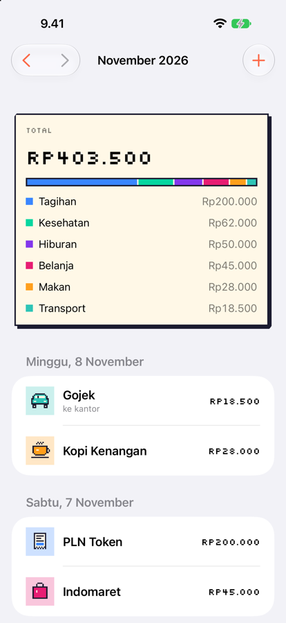
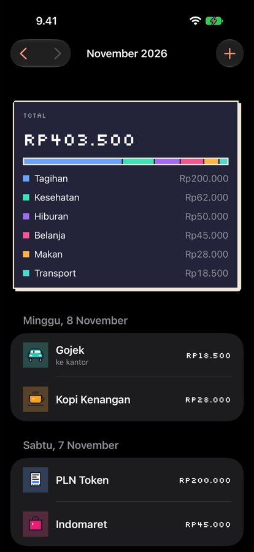
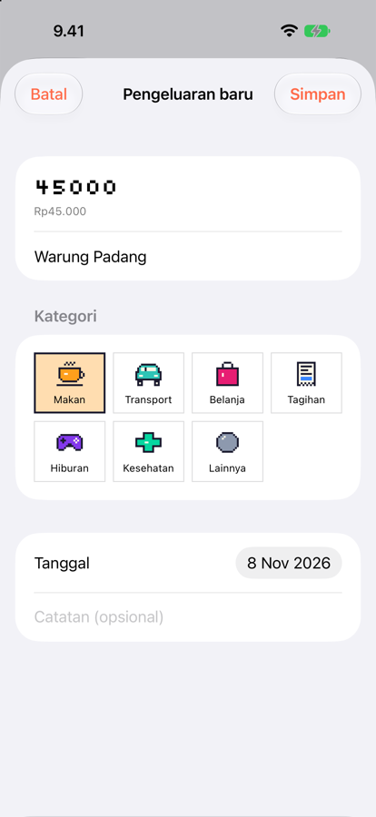
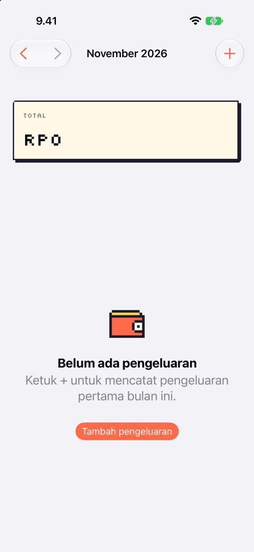

<p align="center">
  
</p>

<h1 align="center">Spendshot</h1>

<p align="center">
  A pixel-art expense tracker for iPhone. Log a purchase in seconds and see where your money went this month.
</p>

<p align="center">
  
  
  
  
</p>

## Features

- **Fast entry.** Amount, merchant, category, date and an optional note on one sheet.
- **Monthly summary.** Total spend plus a breakdown by category, with month-to-month navigation.
- **Daily grouping.** Expenses are listed by day, newest first. Tap to edit, swipe to delete.
- **Offline and private.** Data stays on the device (SwiftData). No account, no tracking.
- **Made for Indonesia.** IDR amounts and Bahasa Indonesia UI (`id_ID` locale).
- **Pixel-art style.** Custom pixel icons, the Silkscreen pixel font for totals, and full dark mode support.

## Requirements

- Xcode 27 or later
- iOS 17.0 or later (iPhone only)

## Getting started

```bash
git clone git@github.com:rizkyhaksono/spendshot.git
cd spendshot
open spendshot.xcodeproj
```

Select an iPhone simulator and press **⌘R**.

To launch with sample data (Debug builds only), add `-seedSampleData` under **Product › Scheme › Edit Scheme › Run › Arguments**.

### Command line

```bash
xcodebuild -scheme spendshot -destination 'platform=iOS Simulator,name=iPhone 17' build
xcodebuild -scheme spendshot -destination 'platform=iOS Simulator,name=iPhone 17' test
```

## Project structure

```
spendshot/
├── SpendshotApp.swift        # App entry, SwiftData container, locale
├── Models/                   # Expense (@Model), Category
├── Features/
│   ├── ExpenseList/          # Monthly list, summary card, rows
│   └── ExpenseForm/          # Add / edit sheet
├── Shared/                   # Formatting, theme, preview data
├── Resources/Fonts/          # Silkscreen (OFL)
└── Assets.xcassets/          # App icon, pixel icons, color palette
spendshotTests/               # Swift Testing unit tests
docs/superpowers/             # Design spec and implementation plan
```

## Tech notes

- **SwiftUI + SwiftData.** Views use `@Query` and `modelContext` directly, with no extra view-model layer.
- **Money is `Decimal`.** Floating-point types are never used for amounts.
- **Month filtering runs in `#Predicate`**, so only the selected month is fetched.
- **Swift 6 concurrency defaults.** The project uses MainActor default isolation.

## Roadmap

- [x] v1: manual entry, monthly summary, pixel-art UI, dark mode
- [ ] Receipt scanning: snap a receipt, and a small backend uses Gemini to fill in the merchant, total, date and category. The API key stays on the server and never ships in the app.
- [ ] iCloud sync
- [ ] Monthly budgets

## Credits

- [Silkscreen](https://github.com/googlefonts/silkscreen) by Jason Kottke, licensed under the [SIL Open Font License 1.1](spendshot/Resources/Fonts/OFL.txt).
